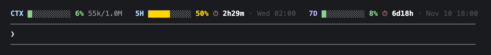
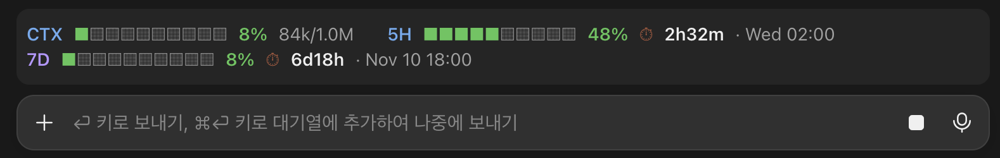

# usage-band

[English](README.md) | 한국어

프롬프트 위(또는 아래)에 밴드를 하나 그려 컨텍스트 사용량과 5시간·7일 사용 한도(rate limit) 소진율을 보여 주는 Claude Code mod입니다. 각 한도가 초기화되기까지 남은 시간과 초기화되는 현지 시각도 함께 표시합니다.

```
CTX ████░░░░░░ 42% 85k/200k   5H ████████░░ 85% ⏱ 9h20m · 23:20   7D █░░░░░░░░░ 12% ⏱ 3d19h · Sat 09:00
```

초기화 시각은 컴퓨터의 현지 시간대 기준으로 표시되며, `TZ` 환경 변수가 설정되어 있으면 그 시간대를 따릅니다.

세션의 첫 응답이 오기 전(또는 `/compact` 직후)에는 컨텍스트 막대가 `CTX ░░░░░░░░░░ –% –/200k`처럼 빈 상태로 남아 있습니다.

## 위치

`position` 옵션으로 밴드를 그릴 위치를 정합니다.

| 값 | 위치 |
| --- | --- |
| `above` (기본값) | 프롬프트 입력창 위. ctrl+x ctrl+a로 접을 수 있음 |
| `below` | 프롬프트 입력창 아래, 모드 줄 밑의 마지막 행 |

설치할 때 옵션 화면에서 고르거나, 나중에 `/config`의 usage-band 항목에서 바꿀 수 있습니다.

## 색상

각 구간(CTX, 5H, 7D, SPEND)의 막대와 퍼센트는 사용량에 따라 색이 바뀝니다.

| 사용량 | 색상 |
| --- | --- |
| 50% 미만 | 초록 |
| 50% – 84% | 노랑 |
| 85% 이상 | 빨강 |
| 아직 데이터 없음 (`–%`) | 회색 |

라벨 색은 고정입니다. `CTX`와 `5H`는 파랑, `7D`는 보라, `SPEND`는 주황입니다.

`SPEND`는 Claude 게이트웨이가 지출 한도(spend limit)를 알려 줄 때 나타납니다. 한도를 넘기면 퍼센트가 100%를 넘을 수 있습니다.

## 스크린샷

Claude Code CLI — 한 줄, 꽉 찬 막대:



Claude 데스크톱 앱(Code 탭) — 두 줄로 줄바꿈, 칸으로 나뉜 막대:



## 설치

Claude Code 터미널 세션의 프롬프트에서:

```
/plugin install usage-band --marketplace JQ-WCoding/usage-band
```

마켓플레이스를 추가할지 물으면 `y`로 답한 뒤 설치 범위(scope)를 고릅니다. 사용자 범위(user scope)가 맨 위에 있으니 Enter를 누르면 됩니다.

셸에서:

```
claude plugin install usage-band --marketplace JQ-WCoding/usage-band
```

데스크톱 앱은 CLI와 플러그인을 공유하므로, 터미널에서 설치하면 데스크톱 앱(Code 탭)에도 밴드가 나타납니다. 데스크톱 앱에서 직접 설치하려면 먼저 `claude plugin marketplace add JQ-WCoding/usage-band`로 마켓플레이스를 한 번 추가한 다음, 프롬프트 입력창 옆의 + 를 눌러 Add plugins를 선택합니다.

## 라이선스

[MIT](LICENSE)
