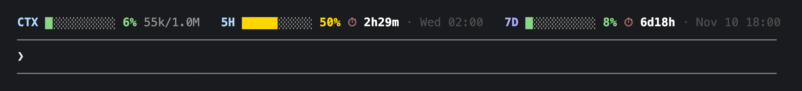
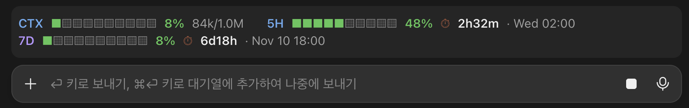

# usage-band

A Claude Code mod that draws a band above (or below) the prompt showing context fill and 5h/7d rate-limit usage, with a countdown and the local time each limit resets.

```
CTX ████░░░░░░ 42% 85k/200k   5H ████████░░ 85% ⏱ 9h20m · 23:20   7D █░░░░░░░░░ 12% ⏱ 3d19h · Sat 09:00
```

Reset times are shown in your computer's local time zone, or in `TZ` when that environment variable is set.

Before the first response of a session (or right after `/compact`), the context bar stays empty as `CTX ░░░░░░░░░░ –% –/200k`.

## Position

The `position` option picks where the band is drawn:

| Value | Where |
| --- | --- |
| `above` (default) | above the prompt input; collapse it with ctrl+x ctrl+a |
| `below` | below the prompt input, as the last row under the mode line |

Set it on the options screen at install, or later in `/config` under usage-band.

## Colors

The bar and percentage of each segment (CTX, 5H, 7D) change color with usage:

| Usage | Color |
| --- | --- |
| under 50% | green |
| 50% – 84% | yellow |
| 85% and above | red |
| no data yet (`–%`) | gray |

Labels keep a fixed color: `CTX` and `5H` blue, `7D` purple.

## Screenshots

Claude Code CLI — one row, solid bars:



Claude desktop app (Code tab) — wraps to two rows, segmented bars:



## Install

At the prompt of a Claude Code terminal session:

```
/plugin install usage-band --marketplace JQ-WCoding/usage-band
```

Answer `y` to add the marketplace, then pick a scope (user scope is first; Enter selects it).

From a shell:

```
claude plugin install usage-band --marketplace JQ-WCoding/usage-band
```

In the desktop app, where `/plugin` does not run: click + next to the prompt box, then Plugins, Add marketplace with `JQ-WCoding/usage-band`, then Add plugin.

## License

[MIT](LICENSE)
